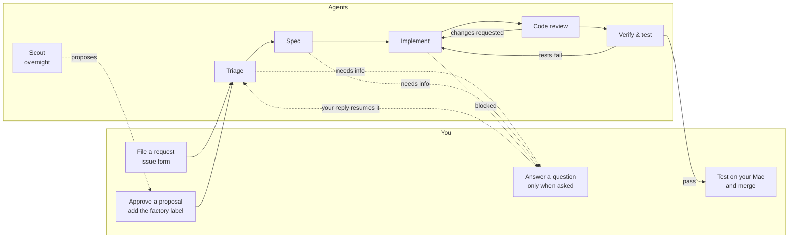

# Software factory

A pipeline of AI agents that takes a feature request from a GitHub issue to a
tested pull request on its own. You file the request; you test the result.



GitHub Actions runs every step: it starts the right agent on each issue event,
commits and pushes for the agents (they never push), opens the draft PR, keeps
a live status comment on the issue, and marks the PR ready when verify passes.

Everything above is declared, not coded. The engine reads it at run time.

| File | What it declares |
|---|---|
| `factory.yaml` | the pipeline: stages, which agent runs each, where each decision goes; budgets; who may use the factory |
| `agents/<name>.yaml` | one agent: model, effort, tools, read or write access, budget, what context it sees, the decisions it can return |
| `prompts/<name>.md` | that agent's instructions |

## Use it

1. File an issue describing the feature and add the `factory` label.
2. Watch the issue. Each agent posts one comment that updates live with what
   it is doing (files it reads and edits, commands it runs), then its report.
3. When it needs you, the issue gets `factory:waiting`. Reply on the issue and
   the same stage runs again with your answer.
4. When it is done, the issue gets `factory:done` and a link to the pull
   request, with the verify agent's steps for testing it on your Mac.

Commands, as an issue comment: `/factory status`, `/factory retry`,
`/factory run <stage>` (comment your guidance first), `/factory stop`.

The issue form is `.github/ISSUE_TEMPLATE/factory-request.yml`; it adds the
label for you. Everything works from the GitHub app on your phone.

## Around the clock

- **02:00 India time** (`factory-scout.yml`): the scout agent reads the code,
  docs and TODOs and files up to `overnight.max_proposals` requests labelled
  `factory:proposed`. Add the `factory` label to approve one; close it to say no.
  Set `overnight.auto_build: true` to build proposals without waiting for you.
- **Every hour** (`factory.yml` heartbeat): anything approved but not running
  is started, oldest first, `policies.max_parallel_requests` at a time.
- **Spending**: per run (`budget_usd` on each agent), per request
  (`budgets.per_issue_usd`) and per day (`budgets.per_day_usd`). At the daily
  cap everything pauses until the next UTC day.
- Merging stays with you: the factory never merges or deploys.

## Change the agents

```bash
python -m factory validate          # checks every file and every route
python -m factory agents            # prints the pipeline
python -m factory new-agent security  # scaffolds agents/security.yaml + prompts/security.md
```

- **Edit** an agent: change its YAML (for example `model: claude-sonnet-5-5`,
  `effort: high`, `budget_usd: 2`, add `Bash` to `tools`) or its prompt.
- **Add** an agent: scaffold it, write its prompt, then add a stage to
  `factory.yaml` and point another stage's decision at it.
- **Remove** an agent: take its stage out of `factory.yaml` and reroute the
  decisions that pointed at it. `validate` tells you if anything still does.

Prompts can use `{test_command}`, `{setup_command}`, `{base_branch}`,
`{spec_dir}`, `{date}`, `{slug}`, `{issue_number}` and `{branch}`.

Agent YAML fields: `name`, `title`, `icon`, `color`, `description`, `model`,
`effort` (low to max), `prompt`, `tools`, `disallowed_tools`, `workspace`
(`read` agents' changes are discarded; `write` agents' changes are committed
and pushed by the engine), `budget_usd` (per run), `context` (any of `issue`,
`comments`, `reports`, `diff`) and `decisions`.

## See the agents

The dashboard lists every agent with its definition and prompt, what each one
is doing right now, every request and where it is in the pipeline, and every
run with its decision, time and cost. It is built from the issues themselves:
each run's record is stored in its issue comment.

- Published to GitHub Pages by `.github/workflows/factory-dashboard.yml`
  after every factory run and every 30 minutes.
- Locally: `GITHUB_REPOSITORY=Meet-Trace/LMemM GITHUB_TOKEN=... python -m factory dashboard --out _site`,
  or `python -m factory dashboard --sample` for example data.

## Where it runs

GitHub Actions (`.github/workflows/factory.yml`), on the runner named in
`factory.yaml` (`runner:`). Each agent is Claude Code in headless mode,
restricted to its declared tools, with a hard per-run budget. The engine, not
the agents, commits, pushes and talks to GitHub; agents never see the GitHub
token, and only comments from `intake.allowed_users` reach them.

One-time setup:

1. Add one repository secret for the agents to run on:
   - `CLAUDE_CODE_OAUTH_TOKEN` to use your Claude Pro or Max subscription. Create
     it on your Mac with `claude setup-token`. Agent runs share your plan's usage
     limits, so heavy days can hit them; a run that hits the limit stops and
     asks you to reply `/factory retry`. Dollar budgets still apply, using the
     cost Claude Code estimates for each run.
   - or `ANTHROPIC_API_KEY` from console.anthropic.com to pay per use.
2. Settings → Actions → General → Workflow permissions: allow GitHub Actions
   to create pull requests.
3. Settings → Pages → Source: GitHub Actions (for the dashboard). On a public
   repository the dashboard is public too.

## Engine

`engine/` is plain Python (PyYAML only): `config.py` loads and validates,
`pipeline.py` is the state machine, `runner.py` runs one agent, `records.py`
stores run records in comments, `dashboard.py` builds the page.
Tests: `python -m unittest discover -s factory/tests -t .`
